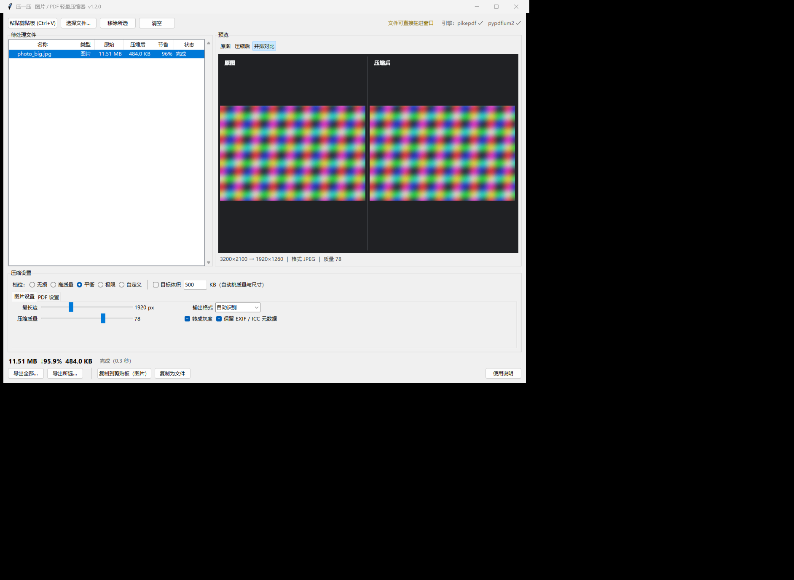
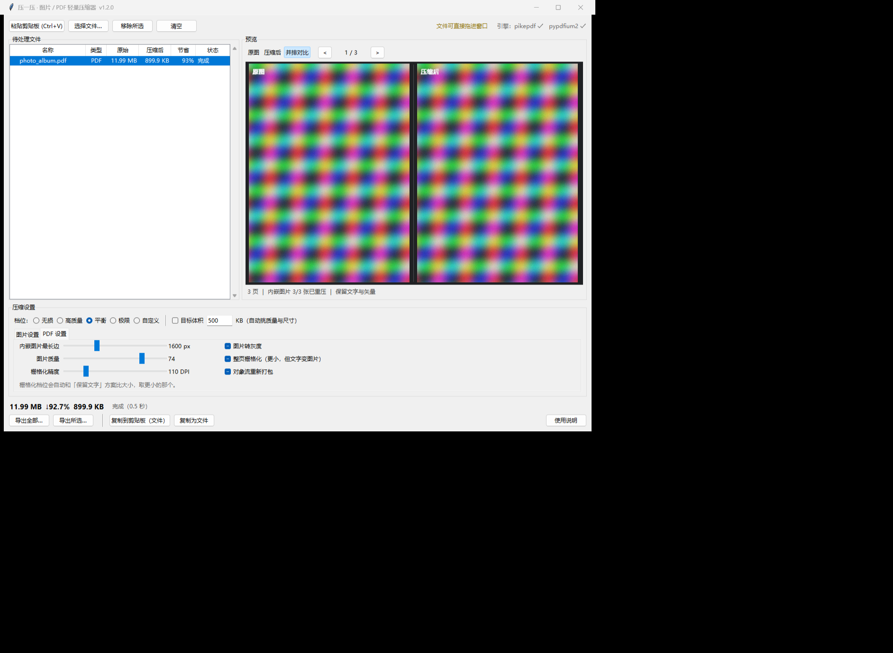

# 压一压 · 图片 / PDF 轻量压缩器

> **粘贴一下，压一压，图片和 PDF 的体积就小了。**
> 离线运行、免安装、不覆盖原文件。

一个 Windows 桌面小工具，解决"文件太大发不出去"这件小事：
截图、手机照片、扫描件、论文 PDF、相册 PDF —— 粘贴进来选个档位，立刻看到压缩后的大小，
满意了导出或直接复制去用。**全部处理都在本机完成，不联网、不上传。**



<sub>图片：原图 / 压缩后并排对比，右侧实时显示体积变化</sub>



<sub>PDF：逐页渲染预览；默认只重压内嵌图片，文字与矢量原样保留</sub>

## 下载使用

- **免安装版（推荐）**：到 [Releases](../../releases) 下载 `压一压.exe`
  （Windows 10 / 11 x64，约 47 MB，**不需要安装 Python 和任何依赖**，双击即用）
- 首次启动约 3–10 秒（单文件 exe 要先解压到临时目录），之后正常。

## 三步上手

1. **粘贴 / 拖进来**：`Ctrl+V` 粘贴截图或复制的图片、PDF（可多个）；也可以把文件甚至整个文件夹**拖进窗口**。
2. **选档位**：无损 / 高质量 / 平衡 / 极限；要精确大小就勾「目标体积」填 KB。
3. **拿走**：`导出` 存成文件（自动加 `_compressed`，**绝不覆盖原文件**），或 `复制到剪贴板` 直接去粘贴。

## 特色

- **粘贴即压**：截图后一个 `Ctrl+V` 就能看到结果和体积，不用先存文件再打开。
- **实时预估体积**：改档位、拉滑块，`11.51 MB ↓96% 484 KB` 这样的结果实时更新。
- **看得见再决定**：原图 / 压缩后 / **并排对比**三种预览；PDF 支持逐页翻看渲染效果。
- **PDF 两种压法**：默认只重压内嵌图片，**文字和矢量原样保留**（可选中、可搜索）；
  「极限」档额外尝试整页栅格化，并**自动取更小的那个结果**。
- **图片智能选择**：截图类 PNG 自动换成**无损 WebP**（体积常降到 1/10 且无压缩痕迹）；照片走 JPEG；自动处理 EXIF 方向与透明通道。
- **安全兜底**：压缩输出自动校验（能打开、页数一致、首页可渲染），**校验不过就退回原文件**；压完反而变大也保留原文件并说明原因。
- **精细控制**：最长边像素、质量、输出格式（JPEG / WebP / PNG / AVIF）、灰度；PDF 可设内嵌图片像素上限与栅格化 DPI。
- **复制到剪贴板会自检**：成功时按钮变 `✔ 已复制`，失败会弹窗说明原因（例如剪贴板被别的软件占用），并可一键改成导出文件。
- **轻**：单个 exe 约 47 MB，不需要安装 Python 和任何依赖。

## 从源码运行

```bash
git clone <本仓库地址>
cd <仓库目录>
python -m pip install -r requirements.txt
python PasteCompress.py
```

也可以双击 `启动压缩器.bat`（要求 PATH 里有 `pythonw.exe`）。
想把依赖装到程序自己的 `libs/` 目录（不污染系统环境）：双击 `安装依赖_可选.bat`。

- 只有 **图片压缩** 需要 Pillow；
- **PDF 压缩**需要 pikepdf（qpdf 内核）或 pypdfium2（PDFium）；
- **拖拽进窗口**需要 tkinterdnd2，没装也不影响其它功能（会自动降级）。

## 命令行批处理

```bash
python PasteCompress.py --cli 文件或文件夹 [--out=输出目录] [--preset=balanced] [--target-kb=300]
# preset: lossless / high / balanced / extreme
```

## 自检

```bash
python PasteCompress.py --selftest          # 造样本 → 逐档压缩 → 校验体积/可打开性
python PasteCompress.py --selftest --selftest-clip   # 附带剪贴板读写测试（会覆盖剪贴板）
```

## 打包成单文件 exe

用 PyInstaller（本项目的 `libs/` 会让分析器找不到部分包，因此显式指定要收集的二进制）：

```bash
python -m PyInstaller --onefile --noconsole --name 压一压 --icon icon.ico ^
  --paths libs --hidden-import pikepdf --hidden-import pypdfium2 --hidden-import tkinterdnd2 ^
  PasteCompress.py
```

（tkdnd / qpdf / pdfium 的二进制建议用 spec 里的 `Tree()` 显式收集，见 `PasteCompress.py` 顶部注释。）

## 已知限制

- 有密码的 PDF 暂不支持，请先去密码。
- 「整页栅格化」后文字会变成图片（不可选中 / 搜索），介意请用另外三档。
- 复制**图片**到剪贴板时，透明区域会填成白色（要保留透明通道请用「导出」）。
- 复制 **PDF** 到剪贴板是「文件」形式：只能在资源管理器 / 微信 / 邮件里 `Ctrl+V` 粘出文件。
- 界面没有做高 DPI 适配（系统缩放 >100% 时会被 Windows 位图缩放，略显模糊）。

## 第三方组件与许可证

本项目代码采用 MIT 许可证（见 `LICENSE`）。运行依赖以下第三方组件，各自遵循其许可证，请一并遵守：

| 组件 | 用途 | 许可证 |
|---|---|---|
| [Pillow](https://python-pillow.org/) | 图片处理 | HPND（MIT 风格） |
| [pikepdf](https://pikepdf.readthedocs.io/) / [qpdf](https://qpdf.readthedocs.io/) | PDF 结构保留压缩 | MPL-2.0 / Apache-2.0 |
| [pypdfium2](https://github.com/pypdfium2-team/pypdfium2) / [PDFium](https://pdfium.googlesource.com/pdfium/) | PDF 栅格化渲染 | Apache-2.0 / BSD-3-Clause |
| [tkinterdnd2](https://github.com/pmgagne/tkinterdnd2) / [TkDND](https://github.com/petasis/tkdnd) | 拖拽文件进窗口 | MIT / Tcl 风格 |

> 从 Releases 下载的 exe 已包含上述组件的二进制。
